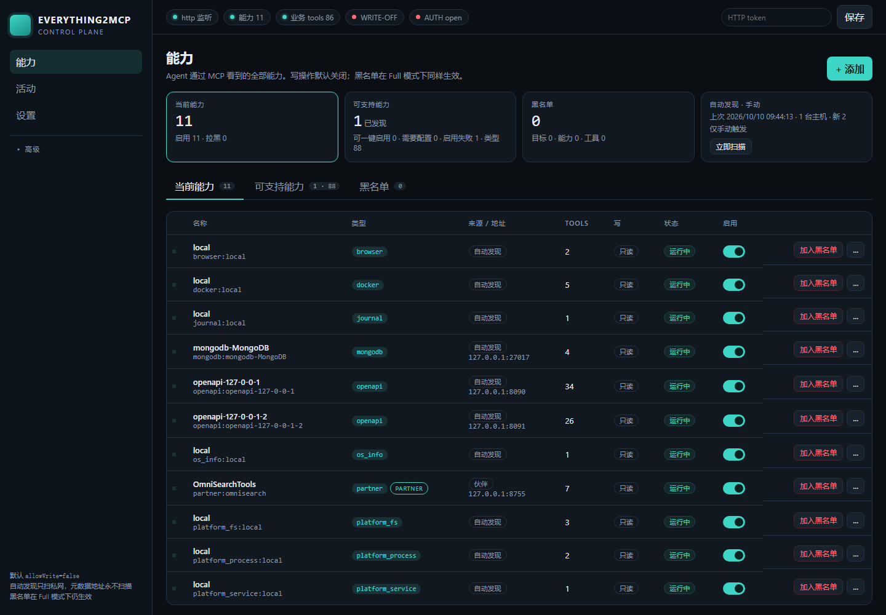
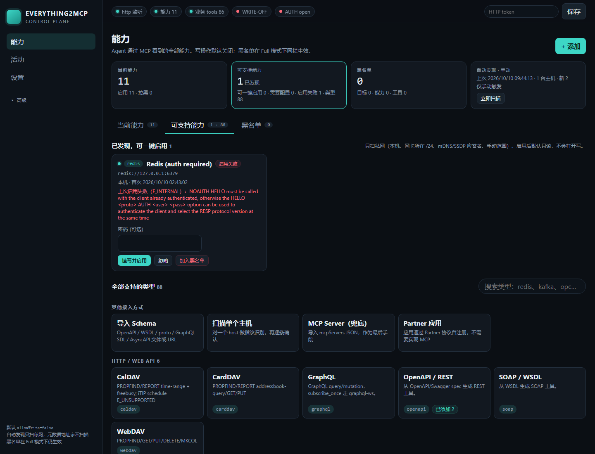
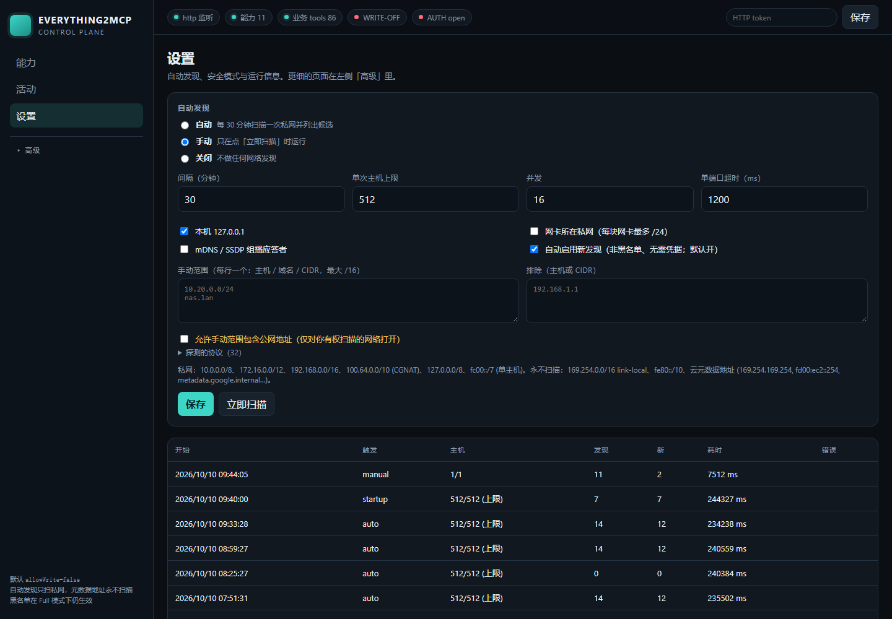
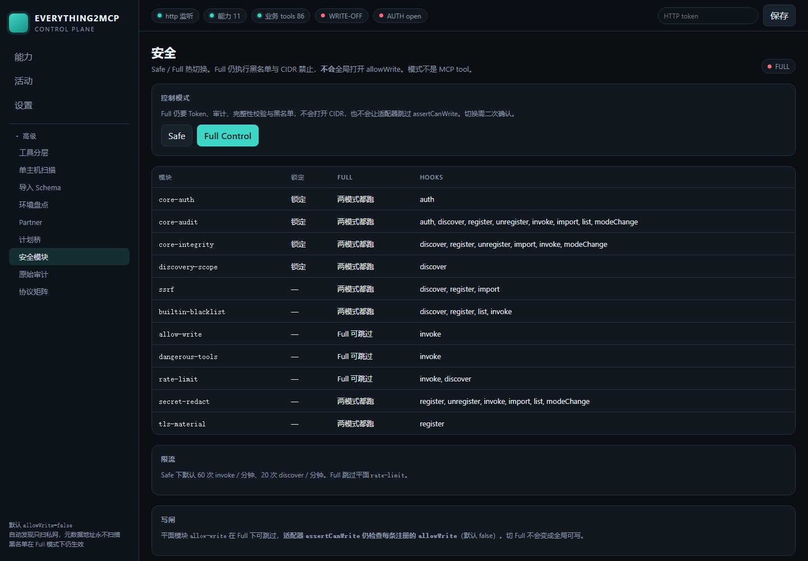
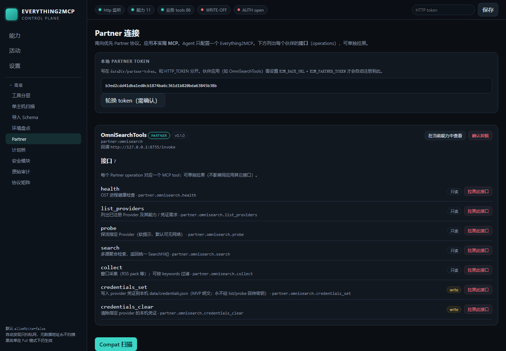

# Everything2MCP

**语言 / Language:** [中文](#中文) · [English](#english)

> **万物都能 MCP** — 本机能力、异构协议、协作套件，尽量收成 **一个** MCP 表面（诚实标注 Implemented / Thin；并非每个适配器都已生产就绪）。
>
> **Everything can become MCP** — local caps, heterogeneous protocols, and chat suites → **one** MCP surface (honest **Implemented / Thin / leftover** labels; not every adapter is production-ready).

[](LICENSE)
[](package.json)
[](docs/AUDIT.md)
[](docs/ARCHITECTURE.md)
[](docs/RELEASE_NOTES.md)
<!-- Replace with live CI once the public remote is set:
[](../../actions)
[](../../stargazers)
-->

**不是**官方 MCP 示例里的 [`everything` server](https://github.com/modelcontextprotocol/servers)——那是 SDK 全功能演示；本仓库是独立的「本机能力 + 南向协议 → 一个 MCP 表面」桥。

**当前快照（Phase X / Partner + Compat）：** 部署 = **最小 MCP 核心**。北向 Agent 只走 MCP；南向默认 **不是 MCP**（Partner 协议 → native OpenAPI 适配器 → `mcp_bridge` 兜底）。能力增长与收缩走共享 **热加载 / 热卸载** 管道。协议状态诚实标注 **Implemented / Thin / leftover**（见 [docs/PROTOCOLS.md](docs/PROTOCOLS.md)）——**不声称全部生产就绪**。测试：`npm test`（约 140 suites / 570）。

## 中文

### 定位：万物都能 MCP

目标不是「又一个 MCP demo」，而是：**凡是 Agent 够得着的东西，都尽量能变成 MCP tools**——本机 OS / Docker / 文件系统、私网服务、OpenAPI / gRPC / MQTT / 队列 / 工业总线、飞书·钉钉·企微 Partner 入口……统一热注册到同一 MCP server。

诚实边界：协议目录用 **Implemented / Thin / leftover** 标注成熟度（见 [docs/PROTOCOLS.md](docs/PROTOCOLS.md)）。Thin = 可用但收窄（模拟器、编码器或有限操作）。**不声称每一个适配器都已生产就绪。** 许可证：**Apache-2.0**。

### 为什么关心

Agent 不该为 REST、MQTT、飞书、本机 Docker、对象存储各接一套客户端。Everything2MCP 把它们收成 **一个** MCP server：

| 痛点 | Everything2MCP 怎么解 |
| --- | --- |
| 协议碎片化 | OpenAPI / gRPC / MQTT / 队列 / 工业总线 / SQL / 对象存储… 热注册成 MCP tools |
| 本机能力被闲置 | 自动发现私网与平台能力（`os_info`、Docker、文件系统等），候选只读、默认不自动启用 |
| 安全焦虑 | 默认 **Safe**、`allowWrite=false`；黑名单 Full 也开；Agent **永不**扫 CIDR |
| 厂商不愿写 MCP | **Partner** 清单 + HTTP invoke；飞书 / 钉钉 / 企微等 native 适配器；`mcp_bridge` 仅兜底 |
| 远程运维 | 默认绑 `127.0.0.1`；HTTP token；**Tailscale / 内网友好**（设 token 后可安全暴露） |

三步心智模型：`mcp_add` / 发现启用 → 适配器映射 tools → Agent 普通 `tools/call`。无需重启（热注册）。

### 面向谁

- **Agent / IDE 用户**（Cursor、Claude Desktop…）——要一个稳定 MCP 入口，而不是 N 个协议客户端
- **平台与集成开发者**——用 Partner SDK 把应用挂进来，**零 MCP 代码**（见 `examples/partner-demo-chat/`）
- **安全敏感的自托管场景**——Safe/Full、黑名单、审计、HMAC 完整性、限流
- **中国协作栈**——飞书 / 钉钉 / 企微 native 路径（模拟器 + `allowWrite` 闸；细节见协议目录）

### 你得到什么

1. **一个 MCP**（stdio 默认；可选 Streamable HTTP `/mcp` + 遗留 SSE）
2. **自动发现** —— 控制台私网扫描 + Agent 单主机探测；本机/平台能力可热加载
3. **Safe / Full 政策** —— 默认只读数据面；Full ≠ 关掉黑名单
4. **同进程控制台** —— `/ui/` 深色 UX：能力 / 活动 / 设置；向导含「测试连接」
5. **Partner 入口** —— 南向应用不写 MCP；ingress 徽章：`partner` / `native` / `mcp_bridge`
6. **诚实协议表** —— Implemented（真实客户端 + 测试）vs Thin（可用但收窄）vs leftover

### Screenshots

实机控制台截图（Edge headless → `http://127.0.0.1:8742/ui/`）。本地先 `EVERYTHING2MCP_TRANSPORT=http npm start`。

| View | Preview |
| --- | --- |
| Capabilities（当前适配器 / tools） |  |
| Discovery / candidates |  |
| Settings（自动发现） |  |
| Security（Safe / Full） |  |
| Partner |  |

**3 分钟上手：** [docs/DEMO.md](docs/DEMO.md)


### 快速开始

克隆本仓库后：

```bash
git clone <repo-url> everything2mcp
cd everything2mcp
npm ci          # 或 npm install
npm run build
npm test        # 应全绿
```

Node **≥ 18.18**。默认 **stdio MCP**（给 Cursor / Claude Desktop；不要当终端 REPL 用）：

```bash
npm start
```

**控制台 + Streamable HTTP + 遗留 SSE**（看 UI 用这条）：先 `npm run build`，再

```bash
EVERYTHING2MCP_TRANSPORT=http EVERYTHING2MCP_HTTP_PORT=8742 npm start
# 控制台:         http://127.0.0.1:8742/ui/
# Streamable HTTP: http://127.0.0.1:8742/mcp
# SSE:             http://127.0.0.1:8742/sse  (POST /messages?sessionId=…)
# REST:            http://127.0.0.1:8742/api/health
# 探活（无 token）: http://127.0.0.1:8742/health
```

Windows PowerShell（连接符用 `;`，不用 `&&`）：

```powershell
$env:EVERYTHING2MCP_TRANSPORT = "http"
$env:EVERYTHING2MCP_HTTP_PORT = "8742"
npm start
```

鉴权：设置 `EVERYTHING2MCP_HTTP_TOKEN`（**离开本机回环前必须设置**），客户端带 `Authorization: Bearer <token>` 或 `x-api-key`。未设置时仅适合受信回环。**Tailscale / 内网曝露前必须设 token**（默认绑 `127.0.0.1`，友好配合内网）。`EVERYTHING2MCP_TRANSPORT=sse` 与 `http` 绑定同一监听器。

同进程控制台在 **`/ui/`**，REST 在 **`/api/*`**，复用 management tools。详见 [docs/CONSOLE.md](docs/CONSOLE.md)。顶栏可粘贴同一 HTTP token。一级页：**能力**（当前能力 / 可支持能力 / 黑名单 三 tab，摘要条计数与 tab 对应）、**活动**、**设置**（自动发现、安全模式）；Tools / Discovery / Import / 矩阵 / 审计 / 计划桥 / 安全 / 热加载 / 伙伴 收进侧栏「高级」。添加能力走按协议 `configSchema` 生成的向导，先**测试连接**再保存。写操作需二次确认且仍受 `allowWrite`。私网**自动发现**默认开启（自动 / 手动 / 关闭），规则见 [docs/DISCOVERY.md](docs/DISCOVERY.md#自动发现auto-discovery)。南向 ingress 徽章：`partner` / `native` / `mcp_bridge`（兜底）。

开发模式：`npm run dev`（`tsx watch`，仍默认 stdio）。

环境变量：

| 变量 | 默认 | 含义 |
| --- | --- | --- |
| `EVERYTHING2MCP_DATA_DIR` | `data` | 注册持久化目录（JSON） |
| `EVERYTHING2MCP_DISCOVERY_ENABLED` | `true` | 是否暴露 `discovery_probe`；`false` 同时关闭自动发现 |
| `EVERYTHING2MCP_DISCOVERY_MODE` | `auto` | 控制台自动发现：`auto` / `manual` / `off`（`node --test` 下默认 `off`） |
| `EVERYTHING2MCP_DISCOVERY_INTERVAL_MIN` | `30` | 自动模式间隔（5–1440 分钟） |
| `EVERYTHING2MCP_DISCOVERY_SCOPES` | — | 额外私网范围（主机 / 域名 / CIDR ≤ /16），逗号分隔 |
| `EVERYTHING2MCP_DISCOVERY_EXCLUDE` | — | 自动发现排除列表 |
| `EVERYTHING2MCP_DISCOVERY_ALLOW_SCAN` | **忽略** | **死变量**。不能让 Agent 工具接受 CIDR；设置了会打日志并强制 `allowScan=false` |
| `EVERYTHING2MCP_DISCOVERY_TIMEOUT_MS` | `2500` | 单次探测超时 |
| `EVERYTHING2MCP_TRANSPORT` | `stdio` | `stdio`（默认）/ `http` / `sse` |
| `EVERYTHING2MCP_HTTP_HOST` | `127.0.0.1` | HTTP/SSE 绑定地址 |
| `EVERYTHING2MCP_HTTP_PORT` | `8742` | HTTP/SSE 端口（避免 3000/5173/8080） |
| `EVERYTHING2MCP_HTTP_PATH` | `/mcp` | Streamable HTTP 路径 |
| `EVERYTHING2MCP_SSE_PATH` | `/sse` | 遗留 SSE GET 路径 |
| `EVERYTHING2MCP_SSE_MESSAGES_PATH` | `/messages` | 遗留 SSE POST 路径 |
| `EVERYTHING2MCP_HTTP_TOKEN` | （空） | 共享密钥；**离开回环前必填**；空则不鉴权（仅适合本机） |
| `EVERYTHING2MCP_HTTP_TOKEN_HEADER` | （空） | 额外 token header（仍接受 Authorization / x-api-key） |
| `EVERYTHING2MCP_INTEGRITY_KEY` | （空） | 可选 HMAC 密钥；也可放 `dataDir/.integrity-key`。空则只用 SHA-256 |
| `EVERYTHING2MCP_RATE_LIMIT_INVOKE` | `60` | Safe 下每分钟业务 invoke 上限；`0` = 不限。Full 跳过 |
| `EVERYTHING2MCP_RATE_LIMIT_DISCOVER` | `20` | Safe 下每分钟 discover 上限；`0` = 不限。Full 跳过 |


## Docker

默认绑定安全：compose 只把宿主机 `127.0.0.1:8742` 映射进容器。容器内监听 `0.0.0.0:8742`（容器网络需要）。**对外网卡暴露时必须设置 token。**

```bash
# 建议先生成 token
export EVERYTHING2MCP_HTTP_TOKEN="$(openssl rand -hex 24)"   # Windows: 用安全随机串

docker compose up --build
# UI:  http://127.0.0.1:8742/ui/
# MCP: http://127.0.0.1:8742/mcp   (Authorization: Bearer $EVERYTHING2MCP_HTTP_TOKEN)
```

或直接：

```bash
docker build -t everything2mcp .
docker run --rm -p 127.0.0.1:8742:8742 \
  -e EVERYTHING2MCP_HTTP_TOKEN=replace-me \
  -v e2m-data:/data \
  everything2mcp
```

详见 `Dockerfile`、`docker-compose.yml`。数据目录挂到 `/data`（对应 `EVERYTHING2MCP_DATA_DIR`）；不要把含 token 的宿主机 `data/` 提交进 git。

## 架构（单进程五包）

```
transport  →  control  →  catalog
control    →  discovery
catalog    →  runtime/bootstrap  →  adapters
```

| 包 | 职责 |
| --- | --- |
| Transport | stdio（默认）+ Streamable HTTP `/mcp` + SSE `/sse` + 同进程 `/ui` `/api`；无业务逻辑 |
| Control Plane | `mcp_*` 管理工具、政策网关（Safe/Full）、黑名单、REST |
| Catalog / Registry | 热注册表、`data/registrations.json`、校验、`list_changed` |
| Discovery & Import | 单主机探测、`discovery_suggest`、`schema_import` |
| Adapter Runtime | SPI + 扁平 `src/adapters/<protocol>/`；v1 **只有 builtins** |

硬约束：adapters 不得 import control/transport；无 `src/core` / `src/management` shim。**逻辑平面**（Environment / Platform / Capability Lifecycle / Policy）叠在五包上，不是新目录。详见 [docs/ARCHITECTURE.md](docs/ARCHITECTURE.md)。

## 热加载 / 热卸载（Phase V 引入，Phase W 补齐热卸载）

Boot **不会**把 os_info / docker / 本机盘点结果写进 catalog。增长与收缩走**同一条** Policy Gateway 管道：

1. 控制台「高级 → 热加载」`#/hotload`（原 `#/capabilities`；日常添加用「能力 → + 添加」向导）：环境盘点或手动 config → 建议列表 → **确认**热加载（Safe+只读可勾 auto）。已挂能力可 **热卸载**（二次确认；不要求 `allowWrite`）。
2. Agent：`environment_inventory` → `capability_register`（`auto:true` 仅 Safe + `allowWrite`/`allowShell`/`allowDesktop`/`allowReadSecrets` 非 true + 非黑名单）
3. Agent / 控制台：`capability_unregister` `{ id }`（与 `mcp_remove` 同一 Catalog.remove；黑名单不拦卸载，但拦再注册）

`capability_register` / `mcp_add` / `mcp_add_from_discovery` / POST `/api/adapters` 走同一 `add()`。`capability_unregister` / `mcp_remove` / POST `/api/capabilities/unregister`（`confirm:true`）/ DELETE `/api/capabilities/:id?confirm=true` 走同一 `remove()`。卸载后 tools 立刻从 Catalog 与 MCP `tools/list` 消失，无需重启。建议列表 **从不**批量自动注册。

新管理工具：`environment_inventory`、`capability_register`、`capability_unregister`、`capability_configure`、**`partner_list`**、**`compat_scan`**。

## Partner / Compat（Phase X）

北向 = MCP only。南向优先级见 [docs/PARTNER.md](docs/PARTNER.md) 与 [docs/COMPAT.md](docs/COMPAT.md)：

1. Partner 协议（应用不写 MCP）。清单 + HTTP invoke。Demo：`examples/partner-demo-chat/`（零 MCP 代码）。
2. Native 适配器：`feishu` / `dingtalk` / `wecom` / `slack` / `notion` / `github`（模拟器 + `allowWrite` 闸）。
3. `mcp_bridge` 兜底导入本地 `mcpServers` JSON（live spawn = `E_UNSUPPORTED`）。

Drops：`~/.everything2mcp/drops/*.json`（Windows `%LOCALAPPDATA%\everything2mcp\drops`）。扫描成功 ≠ 打开写/桌面/密钥。个人微信私聊 **不**宣称 Partner 兼容。

## 安全（已锁定，不再重开）

- **默认 Safe**。数据面默认 `allowWrite=false`。**Full ≠ 全局可写**（适配器 `assertCanWrite` 仍闸）。
- **黑名单 ALWAYS on**，包括 Full（`bypassInFullControl=false`）。粒度：目标 / 能力实例 / 工具 glob（[docs/BLACKLIST.md](docs/BLACKLIST.md)）。
- **Agent 工具只扫单主机**；`EVERYTHING2MCP_DISCOVERY_ALLOW_SCAN` 死变量。控制台自动发现只扫私网（网卡 ≤ /24、手动 ≤ /16、每轮上限），永不扫 link-local / 云 metadata；候选只读、默认不自动启用（L5 修订，见 [docs/SECURITY_ARCHITECTURE.md](docs/SECURITY_ARCHITECTURE.md)）。transport 合同不变；无 shim。
- **Actor-bound audience（Phase M）：** Agent 不能伪造 `audience=console` 看见已拉黑 tools。控制台 REST 写入 `actor.kind=console`。
- 政策网关、HMAC 完整性（`security.json` / `blacklist.json` / `registrations.json`）、`audit.jsonl`、限流、密钥脱敏。
- Plugin SPI：v1 **只加载 builtins**；`inject`/`replace` 钩子留给日后；非 builtin → `E_UNSUPPORTED`。**不做** v2 本地 JS / v3 npm、**不做** Agent 写 challenge。

详见 [docs/SECURITY_ARCHITECTURE.md](docs/SECURITY_ARCHITECTURE.md)、[docs/BLACKLIST.md](docs/BLACKLIST.md)。

## 接入 Cursor / Claude Desktop

MCP 使用 **stdio**。把 `args` 换成本机仓库里 `dist/index.js` 的绝对路径（或相对路径，见 `examples/cursor-mcp.json`）：

```json
{
  "mcpServers": {
    "everything2mcp": {
      "command": "node",
      "args": ["/absolute/path/to/everything2mcp/dist/index.js"]
    }
  }
}
```

相对路径示例见 `examples/cursor-mcp.json`（需在仓库根、且已 `npm run build`）。远程 / Streamable HTTP（需先 `EVERYTHING2MCP_TRANSPORT=http npm start`）：

```json
{
  "mcpServers": {
    "everything2mcp": {
      "url": "http://127.0.0.1:8742/mcp",
      "headers": { "Authorization": "Bearer replace-me" }
    }
  }
}
```

启动后，Agent 应能看到管理工具：`mcp_list`、`mcp_add`、`mcp_update`、`mcp_remove`、`mcp_query_by_protocol`、`mcp_health`、`mcp_explain_tool`、`mcp_plan_bridge`、`mcp_add_from_discovery`、`schema_import`、`discovery_suggest`、`environment_inventory`、`capability_register` / `capability_unregister` / `capability_configure`、`partner_list`、`compat_scan`，以及可选的 `discovery_probe` / `discovery_scan_host`。黑名单管理工具 `mcp_blacklist_*` 给操作员用，默认不要当业务层。

## Agent 自主使用

目标：让 Agent **自己找协议、自己注册、自己调用**，而不是等人手写 `mcp_add`。

推荐顺序：

1. **`mcp_plan_bridge`** — 用自然语言描述目标（「把 10.0.0.8 上的 REST 和 MQTT 接进来」）。返回推荐协议、示例 config、下一步该调哪些 MCP 工具。
2. **`discovery_scan_host`** — 只扫 **一个** hostname/IP。并行探测 OpenAPI/WSDL/GraphQL、gRPC reflection、常见消息/工业/数据端口，以及 Phase N–U 指纹（FTP/SNMP/etcd/WebDAV、IMAP/POP3/Consul、SFTP/Memcached/TFTP、CalDAV/ZK、Cassandra/CouchDB/Whois、Solr **8983** / RabbitMQ management **15672** / Kubernetes **6443** 等）。完整表见 [docs/DISCOVERY.md](docs/DISCOVERY.md)。默认拒绝 CIDR/网段，并拦截云 metadata IP（SSRF）。
3. **`discovery_suggest`** 或直接用 scan 返回的 `suggestions`。
4. **`mcp_add_from_discovery`** — 把 suggestion 一键变成热注册 tools。
5. 若已有 spec 文件/URL：**`schema_import`**（OpenAPI / WSDL / proto / GraphQL SDL / AsyncAPI）。
6. **`mcp_health`** / **`mcp_explain_tool`** — 确认适配器是否 live、某个 `openapi.foo.bar` 怎么调。空注册表时 health 会给出 golden-path hints。

黄金路径有专用回归：`tests/p5-golden-path.test.ts`。

无 proto 的 gRPC：

```json
{ "protocol": "grpc", "name": "edge", "config": { "target": "127.0.0.1:50051", "reflection": true } }
```

AsyncAPI / Sparkplug 示例见 `examples/streetlights.asyncapi.json`、`examples/sparkplug-node.json`。

**不会做的事：** 让 Agent 扫网段、扫 1–65535 全端口、探测云 metadata、NFS 完整客户端。（私网范围与有界 mDNS/SSDP 组播只在控制台自动发现里做。）详见 `docs/DISCOVERY.md`、`docs/ROADMAP.md`。

## 管理工具

| Tool | 参数 | 作用 |
| --- | --- | --- |
| `mcp_list` | `verbose?`, `layer?` | 按层列出：默认 `business`；`management` / `all` |
| `mcp_add` | `protocol`, `name`, `config` | 连接适配器并注册其 tools |
| `mcp_update` | `id`, `config` | 合并配置并重连 |
| `mcp_remove` | `id` | 断开并卸载 tools |
| `mcp_query_by_protocol` | `protocol` | 按协议过滤 |
| `mcp_health` | `verbose?` | 进程 + 适配器健康 |
| `mcp_explain_tool` | `name` | 解释某个 MCP tool 属于哪个适配器 |
| `mcp_plan_bridge` | `goal`, `host?` | 自然语言目标 → 推荐协议与下一步 |
| `mcp_add_from_discovery` | suggestion | 按探测草案注册 |
| `schema_import` | `source`, `kind?`, `register?` | 导入 spec 并可选注册 |
| `discovery_probe` | `host`, `port?` | 单端口 OpenAPI/SOAP/GraphQL 路径 |
| `discovery_scan_host` | `host`, `port?` | 单主机多协议并行探测 |
| `discovery_suggest` | `host` 或 `candidates` | 探测结果 → mcp_add 草案 |
| `environment_inventory` | （无） | 本机盘点 → suggest（不注册） |
| `capability_register` | suggestion 或 protocol/name/config，`auto?` `confirm?` | 热加载（与 mcp_add 同一闸） |
| `capability_unregister` | `id` | 热卸载（控制面，不要求 allowWrite；缺 id → `E_NOT_FOUND`） |
| `capability_configure` | `id`, `config` | 热重配 |

注册 id 形如 `openapi:widgets`。业务 tools 命名：`{protocol}.{name}.{operationId}`。

`tools/list` 里每条 tool 带 `_meta.layer`：`management`（`mcp_*` / `discovery_*` / `environment_inventory` / `capability_*` / `schema_import`）或 `business`。Agent 应优先 `mcp_list { "layer": "business" }`，避免管理工具把上下文撑满。`annotations.title` 也有 `Management ·` / `Business ·` 前缀。

### 添加 OpenAPI 示例

对 MCP 客户端调用 `mcp_add`：

```json
{
  "protocol": "openapi",
  "name": "widgets",
  "config": {
    "spec": "./examples/petstore.openapi.json",
    "baseUrl": "https://your-api.example/v1",
    "auth": { "type": "bearer", "token": "replace-me" }
  }
}
```

成功后会出现 `openapi.widgets.listWidgets`、`openapi.widgets.getWidget` 等 tools。完整配置见 `examples/`。

### MQTT

```json
{
  "protocol": "mqtt",
  "name": "local",
  "config": {
    "url": "mqtt://127.0.0.1:1883",
    "topics": ["sensors/#"]
  }
}
```

暴露 `mqtt.local.publish`、`mqtt.local.subscribe_once`、`mqtt.local.list_topics`。

### SOAP / WSDL

```json
{
  "protocol": "soap",
  "name": "calculator",
  "config": {
    "wsdl": "./examples/calculator.wsdl",
    "endpoint": "http://127.0.0.1:8080/calculator"
  }
}
```

**限制（刻意保持薄实现）：** 按 WSDL 列出 operation，调用时把参数包进 SOAP 1.1 envelope 做 HTTP POST。不解析复杂 XML Schema、WS-Security、MTOM。详见 `docs/PROTOCOLS.md`。

### gRPC

```json
{
  "protocol": "grpc",
  "name": "greeter",
  "config": {
    "proto": "./examples/greeter.proto",
    "target": "127.0.0.1:50051",
    "tls": false
  }
}
```

暴露 unary / server-stream / client-stream / **one-shot bidi** 以及 **session bidi**（`bidi_open` / `bidi_send` / `bidi_recv` / `bidi_close`）。unary invoke：`{ "body": { "name": "Ada" } }`。one-shot bidi：`{ "messages": [{ "name": "Ada" }], "maxMessages": 8 }`。session：`bidi_open { "method": "Greeter_Chat" }` 后按 `streamId` send/recv/close；未读满 `maxMessages` 会 pause。只读动词 RPC 默认放行；`Chat`/`SayHello` 等写侧需 `allowWrite: true`。可选 `ca`/`cert`/`key` PEM。也可用 `protoInline`。

### WebSocket

```json
{
  "protocol": "websocket",
  "name": "echo",
  "config": {
    "url": "ws://127.0.0.1:8080/echo",
    "protocols": [],
    "headers": {}
  }
}
```

别名 `ws`。暴露 `websocket.echo.send`、`websocket.echo.receive_once`。无自动重连。

### GraphQL

```json
{
  "protocol": "graphql",
  "name": "api",
  "config": { "url": "http://127.0.0.1:4000/graphql", "introspect": true }
}
```

`graphql.api.query` / `mutate` / `introspect` / `subscribe_once`。Introspection 成功时还有 `Query_*`、`Mutation_*`。`subscribe_once` 需 `wsUrl`（graphql-ws）或 `simulator:true`。

### AMQP / Kafka / RabbitMQ management

```json
{ "protocol": "amqp", "name": "rabbit", "config": { "url": "amqp://127.0.0.1", "queue": "jobs" } }
```

```json
{ "protocol": "kafka", "name": "events", "config": { "brokers": ["127.0.0.1:9092"], "topic": "orders" } }
```

```json
{ "protocol": "rabbitmq", "name": "mgmt", "config": { "url": "http://127.0.0.1:15672", "allowWrite": false } }
```

AMQP：`publish`、`consume_once` / `get` / `ack`、`list_queues`（线协议 **5672**）。Kafka：`produce`、`consume_once`、`list_topics`、`group_status`（one-shot；**无事务/EOS**；`idempotent` 只是 KafkaJS producer 标志）。`rabbitmq` 是 **management HTTP :15672**，不是 AMQP。

### 薄适配器（工业 / 消息 / 数据 / 平台）

状态分两档（完整合同见 [docs/PROTOCOLS.md](docs/PROTOCOLS.md)）：

- **Implemented** — 真实客户端路径 + hermetic 测试；可连 live 目标（仍受 `allowWrite` / Safe 闸）
- **Thin** — 已注册且 `listTools`/`invoke` 可用，但能力故意收窄（模拟器、编码器、或有限 HTTP/线协议子集）；**不是**「未实现」

下表为摘要；以 `docs/PROTOCOLS.md` 为准。

| protocol | 配置要点 | tools | 限制 |
| --- | --- | --- | --- |
| `opcua` | `endpoint`, `nodes`, `simulator?` | `read` `write` `browse` `subscribe_once` `wait_data_change` | 默认内存地址空间；`subscribe_once` 一次性；`wait_data_change` 为内存 monitored-item |
| `coap` | `host`, `port` | CRUD + `observe_once`/`observe_cancel` | 无 DTLS |
| `nats` | `servers` / `simulator?` | core + `js_publish`/`js_next`/`js_ack` | JetStream consumer/ack/interest 子集 |
| `fix` | `sender`, `target`, `allowWrite?` | logon/heartbeat/logout + encode/decode/status + NOS | 会话 logon/logout/NOS 需 allowWrite；内存 loopback |
| `asyncapi` | `spec`, `brokerUrl?` | `list_channels` `publish` `subscribe_once` | MQTT/WS/Kafka bind 或 dry-run |
| `sparkplug` | `url`, `groupId`, `edgeNode`, `hostId?`, `encoding?` | encode/decode/parse + nbirth/ndeath/publish + **`host_state`** | 官方 protobuf；Host STATE 只读 stub + Host MVP |
| `sqs` | `queue`, `endpoint?`, `allowWrite?` | `list_queues` `send` `receive` `delete` | 内存 / unsigned JSON HTTP；无 SigV4；写入需 allowWrite |
| `ldap` | `url`, `base`, `tls?`, `allowWrite?` | bind/`sasl_bind`/search/compare + **add/modify/delete** | 写入需 allowWrite；SASL **PLAIN only**；**无 GSSAPI** |
| `bacnet` | `host`, `port?`, `udp?`, `allowWrite?` | `who_is` `i_am` `read_property` `list_objects` `write_property` | unicast Who-Is；写入需 allowWrite |
| `ethernetip` / `enip` | `host?`, `tcp?`, `allowWrite?` | `list_identities` `list_tags` `read_tag` `write_tag` | CIP List Identity；本地 tags；无 Forward Open |
| `s7` | `host?`, `rack?`, `slot?`, `tcp?`, `allowWrite?` | `read` `list_areas` `write` | ISO-TCP + Read Var 子集；默认只读 |
| `mtconnect` | `url` / `fixture` / `xml` | `probe` `current` `sample` | HTTP Agent 拉；无 Assets |
| `sql` / `sqlite` / `postgres` / `mysql` | `driver`+`filename`/`url`，`native?` | `query` `execute` `list_tables` `describe` | CI mock / `node:sqlite`；`native:true` 可选 `pg`/`mysql2`/`better-sqlite3` |
| `mongodb` | `simulator:true` 或 `url` | `list_collections` `find` `insert_one` | 无 url 内存；`url` 走 **OP_MSG** 子集；无 aggregation |
| `elasticsearch` / `opensearch` | `url` / simulator | `list_indices` `search` `index_doc` | HTTP `_cat`/`_search`/`_doc`；OpenSearch **同路径别名** |
| `clickhouse` | `url` / simulator | `query` `execute` | HTTP POST + `FORMAT JSONEachRow`；INSERT/DDL 需 allowWrite |
| `neo4j` | `url` / simulator | `cypher` | HTTP `/db/{db}/tx/commit`；**Bolt 仍 `E_UNSUPPORTED`** |
| `sftp` | `host`, `user?`, `password?` | `list` `get` `put` `delete` | **ssh2 SSH-2**；不是 FTP；写需 allowWrite |
| `memcached` | `host?`, `port?` | `get` `set` `delete` `stats` | 文本协议；写需 allowWrite |
| `tftp` | `host?`, `port?` | `get` `put` | RFC1350 RRQ/WRQ；不是 FTP |
| `caldav` | `url?` | `propfind` `report` `freebusy` `get` `put` | time-range + freebusy；iTIP `E_UNSUPPORTED`；写需 allowWrite |
| `carddav` | `url?` | `propfind` `report` `get` `put` | addressbook-query 子集；写需 allowWrite |
| `beanstalkd` | `host?`, `port?` | `stats` `put` `reserve` `delete` | 文本协议；写需 allowWrite |
| `zookeeper` | `host?`, `port?` | `ruok` `get` `create` `watch_once` `multi` | 一次性 watch + MULTI；ACL/SASL `E_UNSUPPORTED` |
| `redis` | `url`, `allowWrite?` | kv + hash/list/stream + pub/sub | 写入需 allowWrite |
| `s3` / `gcs` / `oss` | `bucket` | `list` `get` `put` | 内存 / 签名子集（S3 SigV4、GCS Bearer、OSS HMAC） |
| `dns` | `host?` / `simulator?` | `query` | 单播 A/AAAA/TXT/PTR；无 AXFR / 无组播 |
| `cassandra` | `host?` / `simulator?` | `list_keyspaces` `cql` | native v4 STARTUP/QUERY；写闸 |
| `couchdb` | `url?` / `simulator?` | `all_docs` `get` `put` | HTTP；写需 allowWrite |
| `whois` | `host?` / `simulator?` | `query` | TCP 43 只读 |
| `solr` | `url?` / `simulator?` | `list_cores` `select` `update` | HTTP；写需 allowWrite |
| `rabbitmq` | `url?` / `simulator?` | `list_queues` `publish` `get` | **management HTTP**；不是 AMQP |
| `kubernetes` / `k8s` | `url?` / `simulator?` | list/get pods/services/configmaps | 只读；exec/apply **恒** `E_UNSUPPORTED` |
| `os_info` | （空） | `uname` | 本机 OS；热加载，不在 boot 挂载 |
| `platform_fs` | `roots?` | `list` `read` `roots` | 闸根目录；不可 allowWrite |
| `platform_process` | `allowShell?` | `process_list` `shell_exec` | Linux `/proc`；Win/mac 注入或 gap；shell_exec 闸+stub |
| `platform_service` | `allowShell?` | `service_list` | systemd/sc/launchctl；缺工具 `E_UNSUPPORTED` |
| `docker` | `url?` / `simulator?` | list/inspect | Engine HTTP 只读；`run` 恒 stub |
| `journal` | `path?` / `simulator?` | `read` | syslog 文件；wevtutil/journalctl stub |
| `prometheus` | `url` / `simulator?` | `query` `query_range` `remote_write` | protobuf+snappy 写需 allowWrite；内存 query 按名 |
| `influx` / `influxdb` | `bucket`, `url?` | `write_points` `delete_points` `query` | Flux + `/api/v2/delete`；写/删需 allowWrite |
| `snmp` / `ftp` / `webdav` / `etcd` | 见 PROTOCOLS | get/walk；list/retr；propfind；range/put | SNMP **无 v3**；FTP **不是 SFTP** |
| `imap` / `pop3` | `host` | list/select/fetch；stat/retr | 写闸；**不是 SMTP 发信** |
| `consul` / `azureblob` | `url` | kv/catalog；list/get | Azure SharedKey 子集 / SAS |

### 新增协议示例（XML-RPC / JSON-RPC / FIX / Redis / SMTP / LDAP）

```json
{ "protocol": "xmlrpc", "name": "blog", "config": { "url": "http://127.0.0.1:8080/RPC2", "introspect": true } }
```

```json
{ "protocol": "jsonrpc", "name": "api", "config": { "url": "http://127.0.0.1:8545" } }
```

```json
{ "protocol": "fix", "name": "desk", "config": { "sender": "BUY", "target": "EXCH" } }
```

```json
{ "protocol": "redis", "name": "cache", "config": { "url": "redis://127.0.0.1:6379" } }
```

```json
{ "protocol": "smtp", "name": "mail", "config": { "host": "127.0.0.1", "port": 587, "from": "bot@example.com", "starttls": true } }
```

```json
{ "protocol": "ldap", "name": "dir", "config": { "url": "ldap://127.0.0.1:389", "base": "dc=example,dc=com" } }
```

- **XML-RPC**：`list_methods` / `call`，可 introspect 成 `rpc_*`
- **JSON-RPC 2.0**：`call` / `notify` / `batch`（HTTP，可选 WebSocket）
- **FIX**：内存 transport 上 logon/heartbeat/logout + seq（不是交易所）。**logon/logout/NOS 当写**；encode/decode/session_status 只读
- **Redis**：GET/SET/DEL/KEYS/PUBLISH/SUBSCRIBE_ONCE + hash/list/stream
- **SMTP**：`send_mail`（需 allowWrite）+ `noop`；`raw:true` EHLO/MAIL/DATA；STARTTLS 未广告 → `E_UNSUPPORTED`；不是 IMAP/POP3
- **LDAP**：bind / `sasl_bind` PLAIN / search / compare；`add`/`modify`/`delete` 需 `allowWrite`；`tls` / `starttls`；**无 GSSAPI**
- **数据面**：优先 `sqlite` / `postgres` / `mysql` / `mongodb` / `qdrant` 等具体 id。泛化 `sql` 只是 driver 门面。

完整合同见 `docs/PROTOCOLS.md`。示例配置见 `examples/`（含 `solr-local.json`、`rabbitmq-local.json`、`kubernetes-local.json`）。

## 认证占位

`config.auth`：

```json
{ "type": "none" }
{ "type": "bearer", "token": "..." }
{ "type": "apiKey", "apiKey": "...", "headerName": "X-API-Key" }
{ "type": "basic", "username": "...", "password": "..." }
```

MVP 不包含 OAuth、密钥托管或多租户。

## 发现

`discovery_scan_host` 只探测**单个 host**。网段 / CIDR / 通配符直接拒绝，并拦截 metadata IP。控制台**自动发现**（自动 / 手动 / 关闭）在私网范围内逐主机调用同一探测，结果进「能力 → 可支持能力」；link-local 与云 metadata 永不扫描，组播有界且只收私网应答者。设计见 `docs/DISCOVERY.md`。

## 仓库结构

```
src/transport/     stdio（默认）+ Streamable HTTP `/mcp` + SSE `/sse`；无业务逻辑
src/control/       mcp_* 管理工具、policy、security plane、console REST
src/catalog/       热注册表、JSON 持久化、校验、blacklist、list_changed
src/discovery/     单主机探测；suggest/import 已挂成 MCP 工具
src/runtime/       内核：types/errors/auth/load/log/invoke
src/adapters/      SPI + 扁平协议实现 + 可选 pack 分组
examples/          配置与 OpenAPI/WSDL/proto 夹具
tests/             注册表 + 各适配器 + MCP 语义（~140 suites）
docs/              架构 / ADR / 协议目录 / 发现 / 安全 / 发布说明
ui/                同进程控制台源；构建进 dist/ui
```

依赖：`transport → control → catalog`；`control → discovery`；适配器经 `runtime/bootstrap` 注册；**adapters 不得 import control/transport**。详见 `docs/ARCHITECTURE.md`。

## 文档

索引（中英）：[docs/README.md](docs/README.md)。


- [3-minute demo](docs/DEMO.md)
- [架构](docs/ARCHITECTURE.md)
- [ADR 0001 五包布局](docs/adr/0001-five-package-layout.md)
- [ADR 0002 Audience 绑定 actor](docs/adr/0002-actor-bound-audience.md)
- [Phase M 审查纪要（历史）](docs/PHASE_M_REVIEW.md)
- [协议目录（Implemented / Thin / leftover）](docs/PROTOCOLS.md)
- [发现](docs/DISCOVERY.md)
- [Roadmap（P0–V 执行顺序；下一阶段等用户）](docs/ROADMAP.md)
- [发布说明 / 变更记录](docs/RELEASE_NOTES.md)
- [Web 控制台](docs/CONSOLE.md)
- [安全架构（锁定决策）](docs/SECURITY_ARCHITECTURE.md)
- [黑名单](docs/BLACKLIST.md)
- [TLS / 证书 reconnect 重载](docs/TLS.md)
- [体检与测试覆盖](docs/AUDIT.md)
- [统一错误码](docs/ERRORS.md)

发版与基线见 `docs/RELEASE_NOTES.md`。贡献见 [CONTRIBUTING.md](CONTRIBUTING.md)；安全报告见 [SECURITY.md](SECURITY.md)。

## 开发脚本

| 脚本 | 作用 |
| --- | --- |
| `npm run build` | `tsc` → `dist/`，并 `ui:build` 到 `dist/ui` |
| `npm run ui:build` | 控制台 SPA → `dist/ui` |
| `npm start` | 运行 MCP server（默认 stdio；见 `EVERYTHING2MCP_TRANSPORT`） |
| `npm test` | `tsx --test`（当前基线 115 / 494） |
| `npm run dev` | `tsx watch` |

## 有意不做 / 环境挡住（不是漏写）

- Kafka **真** EOS / cooperative rebalance（需集群；hermetic 状态机 ≠ 线上事务）
- SQL CI 真 Postgres/MySQL **Docker 镜像**（本环境无 Docker；`native:true` 可选动态驱动）
- LDAP **GSSAPI**
- v2 本地 JS / v3 npm **外部安全插件加载**
- MCP **Agent 写 challenge**（只有控制台 `confirm:true`）
- **NFS** 完整客户端 / SHOWMOUNT（已有 NFSv3 NULL ping + simulator exports）
- Agent 侧 mDNS **组播浏览**（单播 `host:5353` 已有；控制台自动发现有有界组播）
- 部署时批量注册能力 / 默认打开桌面控制
- `allowShell` / `allowDesktop` 真执行（只有闸与 stub；扫描从不打开）
- SMB/CIFS 完整 TREE_CONNECT 文件客户端（已有 SMB2 NEGOTIATE + simulator）


## English

### Positioning: Everything can become MCP

Everything2MCP’s goal is **Everything can become MCP** — turn local capabilities, private-network services, heterogeneous wire protocols, and collaboration suites into **one** hot-reloadable MCP surface for agents.

This is **not** the official MCP reference [`everything`](https://github.com/modelcontextprotocol/servers) server (that demos the SDK). This repo is a **local-capability + southbound-protocol → MCP** bridge.

**Honesty:** protocols are labeled **Implemented** vs **Thin** vs leftover in [docs/PROTOCOLS.md](docs/PROTOCOLS.md). Thin means usable but intentionally narrow (simulator, encoder, or limited ops). **We do not claim every adapter is production-ready.**

### One-liner

**Everything can become MCP** — auto-discover local & platform caps, bridge the protocols you already run, gate with Safe/Full — console UX, Partner ingress, Feishu / DingTalk / WeCom, Tailscale-friendly. Licensed **Apache-2.0**.

### Why it exists

Agents should not maintain a separate client for every REST API, queue, industrial bus, or chat suite. Everything2MCP is a single-process MCP server that:

- **Discovers** private-network endpoints and local/platform capabilities (console auto / manual / off; agent tools scan **one host only**)
- **Registers** them as hot-reloadable MCP tools (shared Policy Gateway for add/remove)
- **Gates** invokes with Safe vs Full, always-on blacklist, default `allowWrite=false`
- **Exposes** a same-process dark console at `/ui/` plus Streamable HTTP `/mcp` (and legacy SSE)
- **Prefers** Partner protocol and native OpenAPI adapters (Feishu / DingTalk / WeCom / Slack / Notion / GitHub); `mcp_bridge` is an explicit last resort

### Who it is for

MCP client users (Cursor / Claude Desktop), integrators who refuse to rewrite apps as MCP servers, self-hosters who want Safe defaults and Tailscale-friendly loopback-first HTTP, and teams on Feishu / DingTalk / WeCom.

### Quick start

```bash
npm ci && npm run build && npm test
EVERYTHING2MCP_TRANSPORT=http EVERYTHING2MCP_HTTP_PORT=8742 npm start
# Console: http://127.0.0.1:8742/ui/
# MCP:     http://127.0.0.1:8742/mcp
```

PowerShell (`;` not `&&`):

```powershell
npm ci; npm run build; npm test
$env:EVERYTHING2MCP_TRANSPORT = "http"; $env:EVERYTHING2MCP_HTTP_PORT = "8742"; npm start
```

Set `EVERYTHING2MCP_HTTP_TOKEN` whenever HTTP is reachable beyond trusted loopback (including Tailscale). Default bind is `127.0.0.1`.

Walkthrough + screenshots: [docs/DEMO.md](docs/DEMO.md). Architecture: [docs/ARCHITECTURE.md](docs/ARCHITECTURE.md). Security (locked): [docs/SECURITY_ARCHITECTURE.md](docs/SECURITY_ARCHITECTURE.md). Contributing: [CONTRIBUTING.md](CONTRIBUTING.md). License: [Apache-2.0](LICENSE).

**Phase X + Console Redesign is current.** Southbound is not MCP by default. Test baseline **~140 suites / 570 tests**. Next work waits for an explicit continue.

### Docs language layout

Index: [docs/README.md](docs/README.md).


- Root docs (`README.md`, `CONTRIBUTING.md`, `SECURITY.md`, `CODE_OF_CONDUCT.md`, `docs/DEMO.md`): **CN then EN sections** in the same file.
- Longer docs under `docs/`: **CN-primary body** with an **English summary** block at the top (or CN/EN section headers). Paired `*.zh-CN.md` / `*.en.md` only when a doc grows too large to keep dual in one file.
